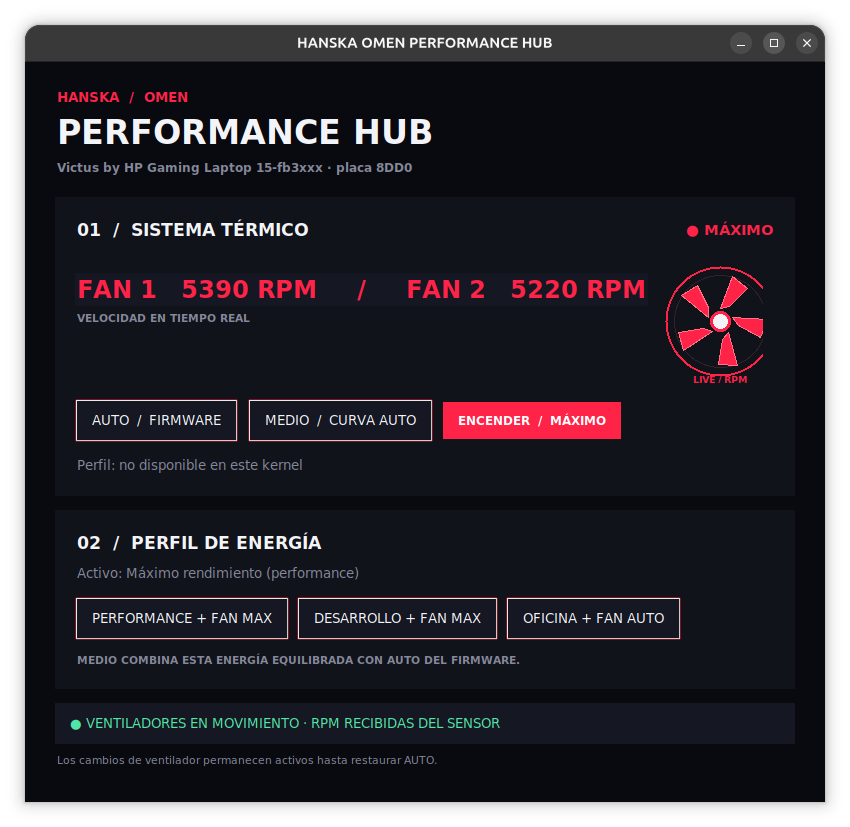

# HANSKA OMEN Performance Hub

## Screenshots



A Linux desktop panel for supported HP OMEN and Victus laptops. It reads fan and platform-profile information from Linux sysfs and lets the user request supported fan modes and Ubuntu power profiles.

## Features

- Shows detected hardware, reported fan mode, fan RPM, and available Ubuntu power profiles.
- Requests firmware automatic fan control or maximum fan mode through the HP WMI interface exposed by the kernel.
- Offers power presets using `powerprofilesctl`: Performance, Balanced, and Power Saver. Fan behavior is paired with these presets as described by the interface.
- Includes a read-only JSON diagnostic CLI (`omenctl.py diagnose`).
- Uses PolicyKit (`pkexec`) to request authorization only for privileged fan changes; the graphical application itself should not be run with `sudo`.

## Important hardware limits

Support depends on the laptop, firmware, kernel, and `hp-wmi` driver. The application checks for a single compatible control before enabling fan changes. The kernel may expose automatic and maximum modes without a manual intermediate RPM control. RPM readings come from the sensor and may remain at zero or be unavailable; this alone does not prove a fan failure. The software cannot guarantee that a requested setting will be honored by firmware or another power-management service.

The panel's “medium” behavior uses automatic firmware fan control with the balanced Ubuntu power profile; it does not set a fixed fan speed. Use automatic mode to return fan control to the firmware.

## Requirements

- Linux with Python 3 and Tkinter.
- `hp-wmi` and compatible sysfs fan controls for fan operations.
- `power-profiles-daemon` / `powerprofilesctl` for power presets.
- PolicyKit (`pkexec`) for privileged fan changes.

On Ubuntu, Tkinter and power profiles can be installed with:

```bash
sudo apt install python3-tk power-profiles-daemon
```

## Run from source

```bash
python3 omen_gui.py
```

Read-only CLI examples:

```bash
python3 omenctl.py status
python3 omenctl.py diagnose
python3 omenctl.py profile list
```

Fan-changing CLI commands require authorization and should be used only on compatible hardware:

```bash
sudo python3 omenctl.py fan auto
sudo python3 omenctl.py fan max
```

## Tests

The included unit tests use simulated sysfs data and do not change real fan settings:

```bash
python3 -m unittest discover -s . -v
```

## License

No open-source license is granted. All rights reserved by the copyright holder.
